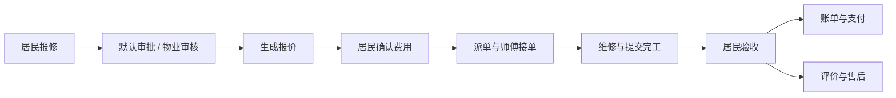

# CommunityFix · 社区报修服务平台

CommunityFix 面向居民、物业和维修人员，提供从报修、报价确认、派单维修到验收、账单与售后的完整协作流程。项目包含 Vue 管理后台、uni-app 微信小程序，以及基于 Spring Boot / Spring Cloud 的服务端。

AI 用于辅助判断报修分类和紧急程度，以及回答社区服务问题；常见问题优先匹配知识库，复杂问题再调用模型，也可以转接人工客服。

> 当前版本适合开发、演示和部署验证。支付为可选的模拟流程，尚未接入真实微信支付；服务器上线与微信真机验收需在目标环境完成。

## 功能概览

| 使用者 | 主要功能 |
| --- | --- |
| 居民 | 微信或账号登录、房屋绑定、图文报修、确认报价、维修进度、验收、账单、评价投诉、售后与客服 |
| 维修人员 | 接单与拒单、开始维修、调整费用、上传完工结果、历史工单与客服 |
| 物业 | 小区与住户管理、维修人员管理、参考价维护、报价、派单、超时预警、售后处理、知识库与人工客服 |
| 系统管理员 | 用户和角色管理、跨小区管理、通知投递查询与失败重试 |

- **简化报修流程**：新订单默认审批，可关闭自动审批；已维护分类参考价时自动生成报价，人工费与材料费由后台维护，师傅可提出调整，居民确认后生效。
- **费用编辑与恢复**：报价草稿、差额确认、版本冲突处理和幂等提交，减少重复录入与重复计费。
- **四个微信提醒节点**：报价待确认、师傅接单、师傅完工待验收、验收后待支付。消息受订阅授权与当前订单状态约束。
- **AI 成本控制**：FAQ 直接回答、上下文长度限制、按场景限制输出、每日用量统计、限流与失败降级。每日用量阈值用于日志提醒，不是费用硬上限。
- **数据与权限**：按角色和小区控制访问，保留工单操作历史，附件私有存储并通过短期签名访问。

## 业务流程



上图展示居民自费工单的主要路径；公共设施工单不向居民收款。实际流转还包括取消、拒单、返修和报价变更，详见 [业务规则](docs/business-flow.md)。

## 技术架构

| 层级 | 技术与职责 |
| --- | --- |
| 管理后台 | Vue 3、TypeScript、Vite、Element Plus、Pinia |
| 移动端 | uni-app、Vue 3；微信小程序和 H5 联调 |
| 服务端 | Java 21、Spring Boot 3.5、Spring Cloud 2025、Spring Security、MyBatis-Plus |
| 网关与注册 | Spring Cloud Gateway、Eureka |
| 数据 | MySQL 8.4、Flyway 数据库版本迁移 |
| 文件 | MinIO；本地开发可使用私有文件目录 |
| 异步与实时 | RabbitMQ 微信通知、WebSocket 站内提示、HTTP 长轮询客服消息 |
| AI | 兼容 Chat Completions 的接口、Redis 供应商限流、MySQL 用量与任务记录 |
| 部署 | Docker Compose、Nginx |

本地可只运行 MySQL 与业务服务；完整部署使用 Nginx → Gateway → 业务服务，并启用注册中心及中间件。

## 快速开始

准备 JDK 21、Maven 3.6.3+、Node.js 24、Python 3.11+、Docker Compose。下面是 Windows PowerShell 的最小开发流程，所有命令从仓库根目录执行。

```powershell
git clone https://github.com/nanbuye-png/CommunityFix.git
cd CommunityFix

# 生成本机配置与随机开发密码，不覆盖已有配置
python deploy/init-dev.py

# 启动开发数据库，等待状态变为 healthy
docker compose --env-file deploy/.env -f deploy/compose.yml -f deploy/compose.dev.yml up -d mysql
docker compose --env-file deploy/.env -f deploy/compose.yml -f deploy/compose.dev.yml ps mysql

# 安装前端依赖
npm --prefix admin-web ci
npm --prefix miniapp ci

# 启动业务服务，首次启动会执行数据库迁移
powershell -NoProfile -ExecutionPolicy Bypass -File deploy/run-backend.ps1
```

另开终端启动管理后台：

```powershell
npm --prefix admin-web run dev
```

访问 `http://localhost:5173`。初始管理员账号为 `admin`，密码见本机 `deploy/.env` 的 `BOOTSTRAP_PASSWORD`。开发脚本启用演示模式；正式环境应关闭演示模式。

居民 / 维修端 H5 联调可另开终端运行 `npm --prefix miniapp run dev:h5`，访问 `http://localhost:5174`。微信小程序需要额外配置 AppID、后端凭据和手机可访问的 API 地址，见 [开发指南](docs/development.md)。

## 配置与部署

- **第一次部署？** 从 [Ubuntu 22.04 / 2 核 4 GB 逐步部署手册](docs/first-server-deployment.md) 开始，包含服务器操作、配置填写、手机验证和故障排查。
- [开发指南](docs/development.md)：本地启动、角色账号、微信预览与连接问题。
- [部署指南](docs/deployment.md)：Docker Compose、公网 IP 调试与升级。
- [配置说明](docs/configuration.md)：微信模板、AI、自动审批和中间件。
- [验证指南](docs/testing.md)：构建、隔离回归、备份恢复和性能验证。
- [API 文档](docs/api.md)：认证、工单、费用、客服与通知接口。
- [技术文档索引](docs/README.md)：更多模块说明。

仓库提供配置示例，不包含真实密钥、业务数据、上传附件或依赖安装目录。数据库结构由 `backend/src/main/resources/db/migration/` 中的迁移脚本初始化，无需额外获取 SQL 导出文件。

## 项目结构

```text
CommunityFix/
├── admin-web/       管理后台源码与依赖锁文件
├── miniapp/         微信小程序 / H5 源码与构建脚本
├── backend/         业务服务、数据库迁移与自动化测试
├── gateway/         API 网关
├── registry/        Eureka 注册中心
├── deploy/          配置示例、容器配置、启动和验收脚本
├── docs/            开发、部署、接口与模块文档
├── evaluation/      辅助报修 AI 合成评测样例
└── pom.xml          Java 多模块构建入口
```

## 当前边界

- 微信登录和订阅通知需要自己的小程序配置。公网 IP + HTTP 仅用于开发调试；面向普通用户发布时需要符合微信要求的 HTTPS 服务和合法域名。
- 模拟支付不产生真实交易。真实微信支付、退款与对账仍需接入。
- AI 回复不代替物业规则或人工判断；知识检索采用关键词匹配，评测样例是合成数据，不是生产质量承诺。
- 本地测试通过不代表生产环境已验收；上线前需验证手机访问、通知送达、备份恢复和服务器运行状态。
