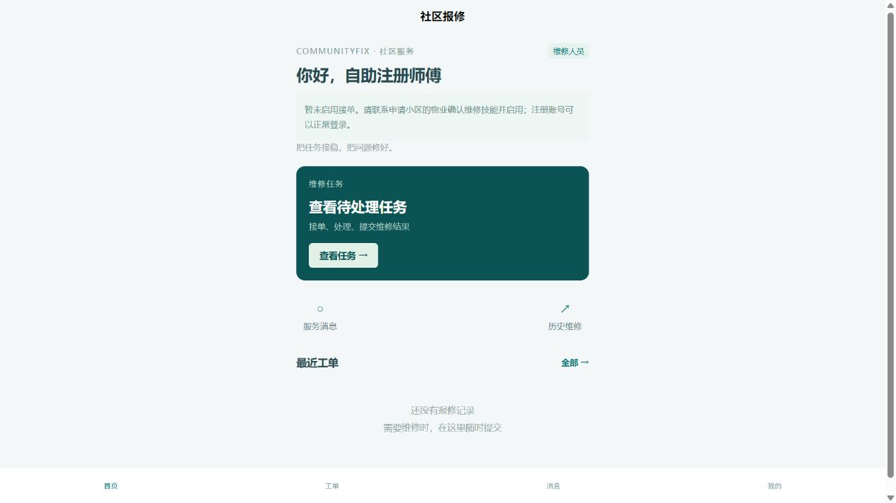
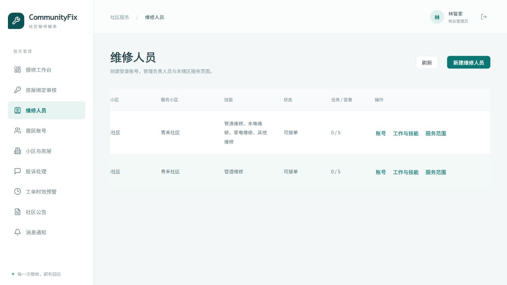
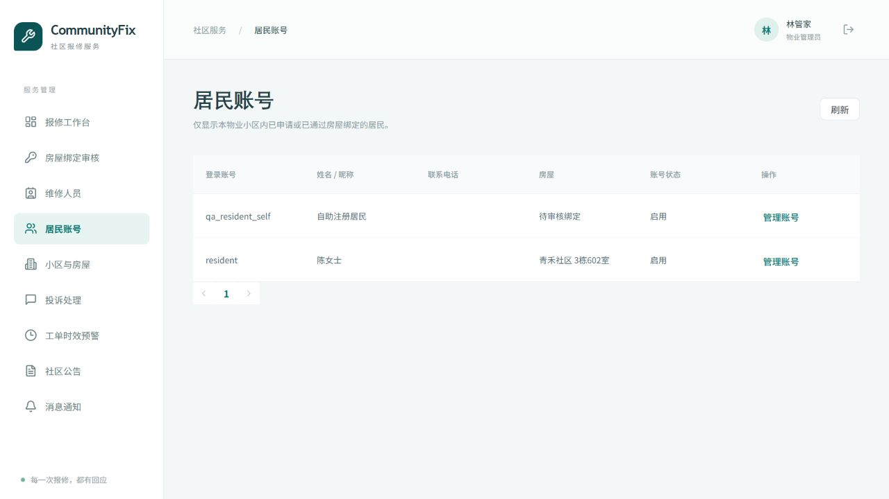

# 居民与维修人员自主注册（2026-10-30）

## 使用方式

更新代码后重启业务后端，重新启动前端开发服务（或重新构建发布）。本功能复用已有 V5 维修档案结构，没有新增或修改已执行迁移。启动命令见 [本地启动指南](vscode-local-testing.md)。

- 居民入口：http://localhost:5174/#/pages/login/index?role=RESIDENT
- 维修入口：http://localhost:5174/#/pages/login/index?role=WORKER
- 管理端：http://localhost:5173

在登录页选择身份，点击“创建居民或维修账号”，填写账号、姓名和密码。账号为 3～50 位字母、数字或下划线；密码至少 12 个字符、最多 72 个 UTF-8 字节，不能全为空白。重复账号会被拒绝。

居民注册后直接进入居民首页，申请房屋绑定，物业审核通过后即可报修。未绑定任何房屋的居民由系统管理员全局管理；提交某小区的绑定申请后，该小区物业可在“居民账号”管理其姓名、电话、密码和账号状态。

维修人员注册时选择申请服务小区。服务端在一个事务中创建 WORKER 账号、维修档案和服务关系，该小区同时作为负责小区。注册后可登录，初始状态为停止接单且未配置技能。负责物业进入“维修人员 → 工作与技能”，核实技能并设置为“可接单”后即可参与派单。维修端返回首页或刷新会获取最新工作状态。

两个 H5 标签页可以各自注册、登录和刷新，沿用标签页级会话；微信小程序继续使用原有本地存储。微信账号授权登录流程不变，本次身份选择注册适用于账号密码注册。

## 权限边界

| 操作者 | 管理范围 |
|---|---|
| 系统管理员 SUPER_ADMIN | 所有账号、维修档案、负责小区及跨物业服务关系；继续创建和管理物业账号 |
| 负责小区物业 ADMIN | 负责维修人员的账号、工作状态、技能及总容量；本辖区服务关系 |
| 其他共享服务小区物业 | 已共享的本辖区服务关系，不可修改全局维修账号资料 |
| 居民所在小区物业 | 本辖区存在待审核或已通过房屋绑定的纯居民账号；只返回本辖区已通过绑定的地址 |
| 自助注册者 | 仅可选择 RESIDENT 或 WORKER，不能注册 ADMIN / SUPER_ADMIN |

物业居民管理接口拒绝修改角色，也拒绝管理带其他角色的账号。账号停用或重置密码会使该账号已有会话失效。既有后台代建账号入口保留，居民与维修人员无需再依赖它才能注册。

跨物业维修人员的首次共享、负责小区转移、未完成任务阻止解除服务等规则见 [维修人员管理说明](worker-management-2026-10-29.md)。

## 接口兼容

- POST `/api/auth/register`：新增可选 `role` 和 `communityId`；旧请求不传角色时仍注册居民，WORKER 必须提交有效小区。
- GET `/api/auth/registration-communities`：公开返回可申请的有效小区 ID 和名称。
- GET `/api/workers/me`：维修人员获取自己的档案与当前工作状态。
- GET / PATCH `/api/system/community-users[/{id}]`：物业分页查询、管理本辖区居民；修改写入操作日志。
- `/api/workers` 及其账号、技能、服务范围专用接口沿用既有权限判断。

## 本轮验证

- 真实隔离 MySQL：55 项后端测试全部通过，0 失败、0 错误、0 跳过，测试数据库和测试用户清理通过。报告：`.local/acceptance/tests-ea76bad3f328/report.json`。
- 集成测试覆盖自主选择身份、维修档案初始禁接单、非法角色拒绝、非法小区无残留账号、负责物业启用、其他物业越权拒绝、居民绑定前后管理范围及禁止角色提权；原业务和维修管理回归同时通过。
- 管理端构建、miniapp 类型检查、H5 与微信包构建通过。微信包使用本机模拟器 API 地址，只代表构建验证。
- 浏览器同源双标签页：居民和维修人员分别注册成功，刷新后保留各自身份。
- 浏览器维修流程：选择小区注册 → 未启用提示 → 物业列表出现新账号 → 配置技能并设为可接单 → 维修首页刷新后提示消失。
- 浏览器居民流程：注册 → 申请房屋绑定 → 物业“居民账号”出现待审核居民 → 修改昵称并保存成功。
- UI 使用独立临时数据库和 18084/18093/18094 端口，关闭真实 AI 与微信配置；不写入开发数据库。
- 结束后临时 UI 进程已停止，数据库和用户清理成功（脚本退出码 0，输出 `UI database cleanup complete`），开发数据保留。

本轮验证针对自主注册及账号管理。没有重新执行完整容器压测、手机人工操作、真实微信投递或含图片上传的全业务浏览器闭环，不能以本报告替代这些验收。

可重复运行 `python deploy/test-backend-isolated.py`；临时浏览器环境使用 `python deploy/worker-ui-check.py`，结束时创建 `.local/worker-ui/stop` 文件，脚本会停止自建进程并清理自建数据库和用户。

