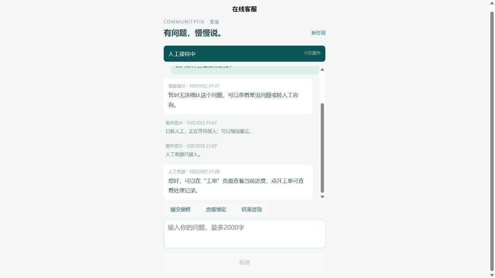
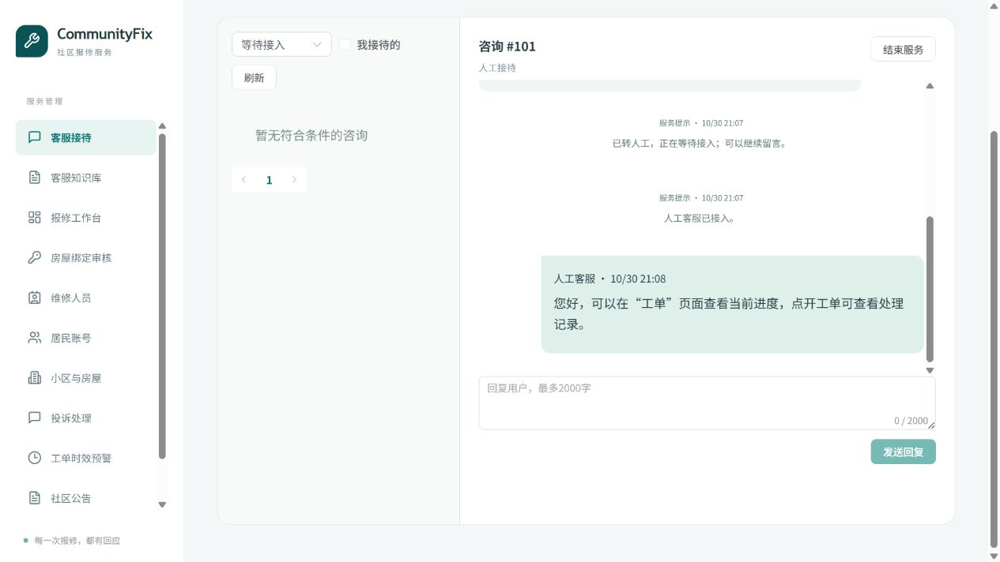
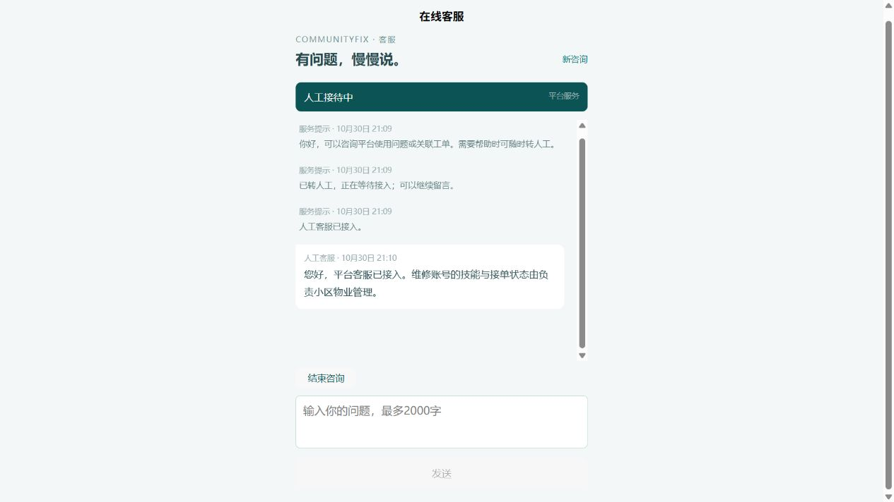

# AI 客服与人工实时接待

## 启动与使用

更新后按 [本地启动指南](vscode-local-testing.md) 重启后端和两端前端。后端自动执行新增 V6 迁移，已有迁移不变。不要手动删除客服表回退；需要回退数据库时恢复备份。

- 居民／维修入口：http://localhost:5174/#/pages/support/index，也可从首页、消息页或工单详情进入。
- 物业／系统管理员：http://localhost:5173/support；知识库：http://localhost:5173/support-knowledge。
- 管理端先开启“在线接待”，选择等待会话后点击“接入咨询”。离开接待台会离线，未结束会话会在维护任务检查后重新排队。
- 在知识库填写标题、关键词、问题、答案、角色和范围，设置“发布”后保存；草稿不供问答引用。关键词建议使用空格分隔的短词，例如“绑定 房屋 审核”。
- AI 默认复用 `AI_ENDPOINT / AI_API_KEY / AI_MODEL`，也支持完整的 `AI_SUPPORT_*` 三项覆盖。没有知识命中仍可正常聊天；未配置或调用失败时显示服务提示，可转人工，不应把降级回复当作真实模型回答。

## 行为和权限

居民可选择待审核或已通过绑定的小区；维修人员可选择负责／服务小区。无归属时使用平台咨询，由系统管理员接待。工单入口由后端确定小区，创建后不更换上下文。

会话状态为 AI、WAITING、HUMAN、CLOSED。排队时可继续留言或取消排队恢复 AI；人工接待后 AI 停止回复。仅当前接待人可发人工消息，admin 可接管。结束后只读，关闭 90 天后清理；7 天无活动自动关闭。

物业仅可查看当前授权小区。权限撤销、账户停用、令牌失效在增量消息返回前重新验证。客服心跳间隔 30 秒，90 秒未更新视为离线，维护任务每 15 秒回收失联会话。每用户每分钟 5 次 AI 请求；人工留言不占该额度。

AI 支持日常聊天和上下文追问；具体业务事实依据已发布知识及授权工单，不执行业务操作。操作入口由后端白名单提供，外部模型输入进行脱敏。历史引用保留当时发布的知识快照。消息使用客户端 ID 去重，状态操作使用版本校验；异步 AI 任务用租约及会话代数拒绝旧任务和转人工后的迟到回复。

## 接口与部署

- `/api/support/options`：可选小区与操作者类型。
- `/api/support/sessions`：创建、分页列表；`/{id}`：详情。
- `/{id}/events?after=游标`：带 Authorization 头的长轮询，最长 10 秒，最多返回 100 条，继续按游标补拉。
- `/{id}/messages`：发送文字，`clientId` 与 `content`；`/{id}/read`：读取游标。
- `/{id}/handoff|cancel-wait|claim|takeover|close`：请求体包含 version。
- `/api/support/heartbeat`：在线心跳；`/api/support/knowledge`：查询、新建、更新发布状态。

所有接口使用原 JSON 包装，不新增 Redis/WebSocket 运行依赖。多实例以 MySQL 保存会话、事件、读取位置、在线状态、知识和 AI 任务。正常部署仍通过已有 `/api` 网关代理。

## 本地验收结果

### 2026-11-07 真实 LLM 对话更新

- 取消本地寒暄短路和固定回复映射；无关联工单、无知识命中也调用模型，直接保留其自然语言回答。模型接收最近会话，历史降级消息不作为助手回答传回模型。
- 区分 CHAT、KNOWLEDGE、ORDER：聊天无需引用，知识回答必须使用已检索的知识 ID，工单答复必须有已授权工单。引用校验不等于逐句事实验证。
- 最终隔离后端回归 127 项通过，报告 `.local/acceptance/tests-cc1fa0d6aaa5/report.json`，清理通过。
- 在用户授权供应商与数据范围后，通过 `deploy/evaluate-support-chat.py --run` 完成六轮真实 API 对话，报告 `.local/support-chat-f5a7e95a995b/report.json`；全部返回 AI 来源，清理通过。首轮出现截断及未经证实的物业惯例说法，随后收紧回复长度和事实要求，原始失败报告保留。
- H5 实际页面已显示真实模型的身份介绍和兴趣建议。微信模拟器的真实 LLM 连续对话及手机后台恢复尚未完成，不以此前本地兜底验收代替。日常后端仍需从新版源码启动。

### 2026-11-07 早期日常对话验收（本地话术方案已被上述实现替代）

- 无工单的整句问候、致谢、告别采用本地回复；混合业务问题继续进入客服处理。模型使用当前会话历史，知识答复校验引用；缺少业务依据时提供报修入口、澄清或人工核实指引。
- 旧版隔离复现中，发送“你好”后，实际任务调度及长轮询返回了通用兜底，本轮没有复现服务端完全不回消息。
- 新版完整后端回归 126 项通过，失败、错误、跳过均为 0。报告为 `.local/acceptance/tests-155242e3785c/report.json`。覆盖问候不调用模型、消息重试去重、无知识澄清、多轮历史和无依据引用拒绝；既有权限、超时、人工接管与迟到回复测试通过。
- H5 使用真实隔离后端验证“你好 → 家里的灯坏了 → 那我要怎么提交 → 谢谢”，页面自动显示回复，离开再返回后消息完整，问候回复只出现一次。
- 微信开发者工具打开常规产物 `miniapp/dist/build/mp-weixin`，使用隔离居民账号、不关联工单，连续发送“你好”和“家里的灯坏了，怎么报修？”，模拟器分别自动显示问候与提交报修指引。
- miniapp 类型检查、常规 H5 和小程序构建通过。页面验收使用无供应商配置的本地回复；模型协议测试使用模拟服务。真实供应商对话效果与手机真机网络行为尚未复测。
- 模拟器验收的后端及代理进程已结束。中断遗留的临时库 `cf_ui_3b9f03b4dd084916934c3d1f82934826` 及其专用账号于 2026-11-07 清理，并再次查询确认不存在。日常演示后端需从新版源码重新启动才能加载改动。

以下为先前验收记录。

- 完整后端 68 项：0 失败、0 错误、0 跳过，真实隔离 MySQL；报告 `.local/acceptance/tests-ff63b946b5d5/report.json`。首轮异步认证失败记录保留，修复后重跑通过。
- 管理端构建、miniapp 类型检查、H5、微信构建通过；微信包仅验证本机模拟器地址，不代表真机发布通过。
- 新增测试覆盖客服角色／小区／工单隔离、账号失效长轮询、物业权限撤销、并发抢接、admin 接管、消息去重、状态冲突、离线重新排队、知识撤回、模型引用校验和超时、脱敏、租约接管、迟到回复、限流和数据保留。
- 双实例、100 个独立账号客户端、300 条消息：接收延迟 P95 **365.97 ms**，0 消息错误；停止实例后存活实例发送／读取 **106.06 ms**，原实例重启健康并读取历史 **7.76 秒**。报告 `.local/support-acceptance/report.json`。
- 该性能数据测量客户端 HTTP 收到消息，不包含浏览器渲染时间；直接访问两个业务实例，没有重新测量 Nginx/Gateway 故障发现时间。浏览器实际即时显示另行验证。
- 浏览器验证：居民 AI 未配置降级 → 转人工 → 物业上线接待 → 实时回复 → 结束；物业发布小区问答；维修人员发起平台咨询 → admin 接入并回复。截图位于本目录 screenshots。
- 最终构建确认原首页仍为默认页面，客服 hash 路由可直达，历史会话可补拉。测试结束后两个业务进程、临时前端代理、临时数据库和用户全部清理，报告 cleanup=PASS，开发数据保留。
- 自动化模型测试使用本地模拟服务。真实模型效果、正式微信发布、手机后台网络行为仍需实机验证。

重复验收：

```powershell
python deploy/test-backend-isolated.py
python deploy/support-acceptance.py
# 需要浏览器验收时加 --ui；结束时创建 .local/support-acceptance/stop 文件
```

脚本创建独立随机数据库和用户，使用本地端口 18084/18085；`--ui` 额外提供 18093/18094。仅测试环境使用脚本内演示密码，不读取 deploy/.env。结束时停止自建进程并删除自建数据库和用户，保留开发数据。




