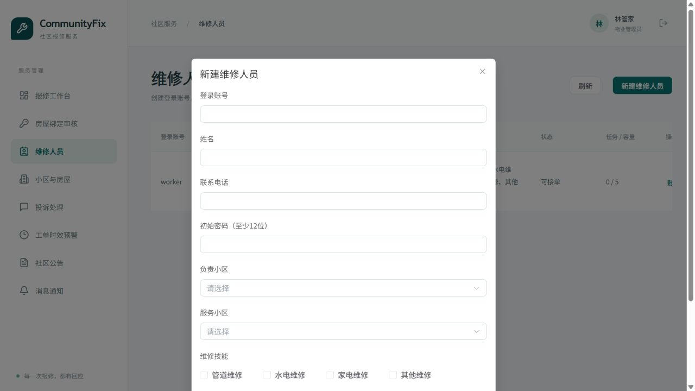
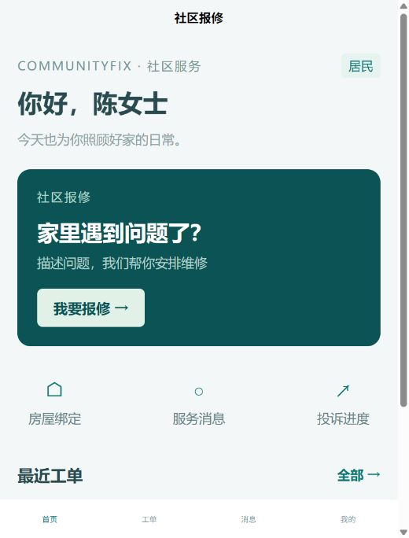

# 双身份测试与维修人员管理修复（2026-10-29）

2026-10-30 已新增居民与维修人员自主注册，无需由管理员代建账号。最新操作与验证见 [自主注册说明](self-registration-2026-10-30.md)。下文原有维修人员管理权限继续有效。

## 启动与入口

按原本的本地开发启动步骤启动 MySQL、后端、admin-web 和 miniapp。后端重启时 Flyway 自动执行 V5；不要手动改写 V1～V4。

在同一浏览器中打开两个标签页：

- 居民：http://localhost:5174/#/pages/login/index?role=RESIDENT
- 维修人员：http://localhost:5174/#/pages/login/index?role=WORKER
- 物业与系统管理员：http://localhost:5173

H5 使用标签页 sessionStorage，刷新保留身份，关闭标签页后重新登录；旧共享登录缓存不再读取。微信包保持 uni 本地存储。不同账号退出互不影响；同一账号退出仍使该账号其他会话失效。

首次更新后重新登录。角色入口不是授权来源，实际角色由服务端确认。首页、工单、个人中心复用页面组件并按身份展示内容；报修、房屋绑定、投诉、维修历史页有身份校验。

## 维修人员管理

在后台“维修人员”点击“新建维修人员”，一次填写登录账号、初始密码、姓名、电话、负责小区、服务小区、技能和总容量。账号与档案在同一事务中创建。

系统管理员另有“关联已有账号”：按账号或姓名搜索，仅显示已有 WORKER 角色且尚未建档的账号，显示格式为“登录账号（姓名）”。无需重复创建同名账号。

| 操作者 | 账号与密码 | 工作状态、技能、总容量 | 服务关系 | 变更负责小区 |
|---|---|---|---|---|
| 系统管理员 SUPER_ADMIN | 全部 | 全部 | 全部 | 可以 |
| 负责小区的物业 ADMIN | 负责人员 | 负责人员 | 自己获授权的小区 | 不可以 |
| 其他服务小区的物业 | 不可以 | 不可以 | 已共享的本辖区服务关系 | 不可以 |
| 无关物业、居民、维修人员 | 不可以 | 不可以 | 不可以 | 不可以 |

首次跨物业共享由系统管理员添加服务小区。物业提交服务范围不会覆盖其他小区的关系；移除后，重新共享需要系统管理员处理。有 ASSIGNED、ACCEPTED、IN_PROGRESS、PENDING_CONFIRM 任务时禁止移除该小区关系。负责小区必须继续包含在服务范围中。

账号停用和密码重置影响所有服务小区，并使现有令牌失效。含其他角色的维修账号只能由系统管理员修改账号资料，防止物业借密码重置获得其他角色权限。

V5 为旧单服务小区档案回填负责小区；多小区或无服务小区档案保持为空，显示“待分配负责小区”，由系统管理员指定。原服务范围、派单数据和总容量保留。

## 接口

- POST /api/workers/accounts：事务创建账号和档案。
- GET /api/workers/account-candidates?q=&page=1&size=20：系统管理员搜索未建档 WORKER 账号。
- POST /api/workers：系统管理员关联已有账号；旧单小区请求可自动推定负责小区，多小区必须明确 ownerCommunityId。
- PATCH /api/workers/{id}/account：资料、密码和启停。
- PATCH /api/workers/{id}：工作状态、技能和容量。
- PATCH /api/workers/{id}/services：当前操作者范围内的服务小区。
- PATCH /api/workers/{id}/owner：系统管理员指定负责小区。

列表增加 username、accountStatus、ownerCommunityId、ownerCommunityName 以及 canManageAccount、canManageProfile、canManageServices、canTransferOwner。物业仅收到自己辖区的服务小区列表。写操作都有后端范围检查和操作日志。

## 本轮验证结果

- 完整后端测试：53 项，0 失败、0 错误、0 跳过；真实隔离 MySQL，运行后数据库及测试用户清理成功。
- 报告：.local/acceptance/tests-c34f048ad8cd/report.json。
- 新增测试覆盖创建回滚、重复账号、关联候选过滤、重复建档、跨物业读取/修改限制、其他辖区关系保留、负责小区转移、账号停用失效、未完成任务阻止解除关系、物业授权撤销。
- 原业务工作流、返修、投诉、并发容量等后端集成测试全部重跑通过。
- 管理端构建、移动端类型检查、H5 构建和微信包构建通过。管理端仍有原有的大 chunk 提示；微信包使用本机模拟器 API 地址进行编译验证。
- 浏览器在同一浏览器内、同一来源的两个标签页实测居民/维修人员同时登录、刷新保留身份、退出互不影响、错误身份入口拒绝及角色页面直接访问限制。
- 浏览器验证物业维修人员列表和新建账号表单；账号创建和共享变更的提交结果由真实 HTTP 集成测试验证。
- UI 验证使用独立数据库、18093/18094 临时入口，后端关闭真实微信和 AI 配置。验证结束后临时进程、数据库及用户已清理，开发数据库未改动。

尚未完成的验收项：本轮未重新以浏览器逐步完成含图片上传的四角色业务闭环、401 注入和旧 V4 业务数据的独立迁移演练；上述项目不以接口测试或编译成功替代验收通过。

可重复命令：

```powershell
python deploy/test-backend-isolated.py
python deploy/worker-ui-check.py
```

第二条启动一次性 UI 检查环境（临时演示密码为脚本中的 QAOnly_20261029!，不得用于真实部署），另一个终端创建 .local/worker-ui/stop 文件即可关闭并清理。仅在本地空闲端口 18084、18093、18094 上运行，不读取 deploy/.env。



